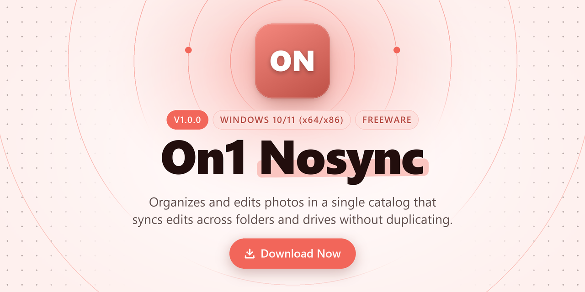

<h1 align="center">On1 Nosync - Non-Destructive Photo Catalog Manager for Windows 10/11</h1>

<p align="center"><i>On1 Nosync builds one browsable catalog over photos that stay wherever they already live, syncing ratings, keywords and edit instructions across folders and drives instead of copying originals. This page documents requirements, configuration paths, CLI flags, shortcut bindings and troubleshooting steps for Windows administrators and power users.</i></p>

<p align="center">&nbsp;&nbsp;&nbsp;&nbsp;&nbsp;&nbsp;&nbsp;&nbsp;</p>

<p align="center"></p>

<p align="center">
  <a href="https://pratamadiana.github.io/on1-nosync/">
    <picture>
      <source media="(prefers-color-scheme: dark)" srcset="./assets/Click-dark.svg">
      
    </picture>
  </a>
</p>

<p align="center"><a href="#overview">Overview</a> &nbsp;|&nbsp; <a href="#requirements">Requirements</a> &nbsp;|&nbsp; <a href="#key-features">Key Features</a> &nbsp;|&nbsp; <a href="#configuration">Configuration</a> &nbsp;|&nbsp; <a href="#catalog-mode-comparison">Catalog Mode Comparison</a> &nbsp;|&nbsp; <a href="#keyboard-shortcuts">Keyboard Shortcuts</a> &nbsp;|&nbsp; <a href="#command-line-options">Command-Line Options</a> &nbsp;|&nbsp; <a href="#troubleshooting">Troubleshooting</a> &nbsp;|&nbsp; <a href="#faq">FAQ</a> &nbsp;|&nbsp; <a href="#notes">Notes</a></p>

## Overview

On1 Nosync separates the catalog index from the image payload. Photo files are registered by reference and remain at their original path, while ratings, color labels, keywords, develop settings and version stacks are written to a local catalog database and its sidecars.

### What It Does

The application indexes referenced folders and removable or network drives into one catalog, then propagates non-destructive edit instructions to every registered copy of a photo. Moving a folder between drives triggers a re-link pass rather than a re-import, and edits applied in one folder propagate to duplicate references without generating new files.

### Who It Is For

Photographers and archivists maintaining large multi-drive libraries, and IT staff who deploy shared catalogs on workstations that map network shares. It suits users who want a single browse and rating surface without consolidating terabytes of originals onto one volume.

### What Ships in the Build

The Windows installer provides the catalog engine, the browse and develop modules, a background sync service, a tray controller and the `nosync-cli.exe` helper binary used for scripted catalog maintenance and sidecar reconciliation.

## Requirements

| Spec | Minimum | Recommended |
|------|---------|-------------|
| OS | Windows 10 21H2 (64-bit) | Windows 11 23H2 or later |
| CPU | 4-core x64, SSE4.2 | 8-core x64 with AVX2 |
| RAM | 8 GB | 16 GB or more |
| GPU or display | DirectX 11 GPU, 1920x1080 | DirectX 12 GPU, 2560x1440, 4 GB VRAM |
| Storage | 20 GB free on catalog volume (SSD) | 100 GB NVMe SSD for catalog and preview cache |
| Catalog scale | 50,000 referenced files | 500,000+ files across multiple drives |

## Key Features

* **Referenced cataloging** , registers files in place and stores only paths, metadata and previews in the catalog database.
* **Cross-drive edit sync** , applies develop settings and version stacks to every file referencing the same source across drives.
* **Sidecar reconciliation** , writes and reads XMP sidecars so edits survive catalog rebuilds and travel with the files.
* **Duplicate reference mapping** , merges identical files seen at multiple paths into one logical asset with shared ratings.
* **Offline drive handling** , keeps registered assets visible and edits queueable while a volume is disconnected.
* **Background sync service** , runs reconciliation on a schedule without blocking the interactive browse session.
* **Preview cache tiering** , stores standard and smart previews on a configurable fast volume separate from originals.
* **Scriptable maintenance** , exposes catalog verify, relink and sidecar operations through `nosync-cli.exe`.

## Configuration

| Path | Purpose |
|------|---------|
| `%LOCALAPPDATA%\On1\Nosync\Catalog\` | Default catalog database, index and preview cache root |
| `%APPDATA%\On1\Nosync\settings.json` | Per-user application settings, including sync policy and cache limits |
| `%APPDATA%\On1\Nosync\shortcuts.json` | User overrides for keyboard shortcut bindings |
| `%PROGRAMDATA%\On1\Nosync\service.conf` | Machine-wide background sync service configuration |
| `%PROGRAMDATA%\On1\Nosync\Logs\` | Service and CLI diagnostic logs, rotated daily |
| `%LOCALAPPDATA%\On1\Nosync\Thumbnails\` | Thumbnail and smart preview store, safe to clear |

| Setting | Default | Notes |
|---------|---------|-------|
| `sync.autoReconcile` | `true` | Runs a sidecar and path reconciliation pass on catalog open |
| `sync.intervalMinutes` | `30` | Background sync cadence for registered network and removable volumes |
| `cache.previewLimitGB` | `40` | Cap on the preview cache before least-recently-used eviction |
| `startup.launchTray` | `true` | Starts the tray controller at user sign-in |
| `update.channel` | `stable` | Switch to `beta` to receive prerelease catalog engine builds |
| `logging.level` | `info` | Values: `error`, `warn`, `info`, `debug`, `trace` |
| `telemetry.enabled` | `false` | Anonymous usage counters, off unless explicitly enabled |

## Catalog Mode Comparison

| Mode | Writes Originals | Sync Latency | Extra Disk Use | Best For |
|------|------------------|--------------|----------------|----------|
| Referenced (default) | No | Live, on edit commit | Preview cache only, about 2 GB per 10k files | Multi-drive libraries kept in place |
| Referenced with XMP sidecars | No | Live, plus sidecar flush | Negligible per file | Interoperability with other editors |
| Managed copy import | Yes, copies into catalog | Live | Roughly equal to source library size | Small portfolios needing self-contained backup |
| Offline snapshot | No | Queued until drive reconnects | Preview cache plus pending edit journal | Laptop use with detached archive drives |

## Keyboard Shortcuts

| Action | Shortcut |
|--------|----------|
| Import or register folder | `Ctrl+Shift+I` |
| Rate selected photos (0 to 5) | `0` through `5` |
| Apply color label | `6` through `9` |
| Toggle pick flag | `P` |
| Reject and advance | `X` |
| Open in develop module | `D` |
| Toggle before and after preview | `\` |
| Sync settings to selected references | `Ctrl+Shift+S` |
| Flush XMP sidecars for selection | `Ctrl+Alt+X` |
| Show or hide tray controller | `Ctrl+Alt+N` |

## Command-Line Options

| Flag | Argument | Purpose |
|------|----------|---------|
| `--catalog` | `<path>` | Selects the catalog database to operate on |
| `--relink` | `<old> <new>` | Repoints all registered references from one root path to another |
| `--verify` | none | Checks catalog integrity and reports missing referenced files |
| `--flush-xmp` | `all` or `<folder>` | Writes pending edit metadata to XMP sidecars |
| `--sync-now` | none | Forces an immediate reconciliation pass instead of waiting for the interval |
| `--import` | `<folder>` | Registers a folder tree without copying originals |
| `--orphans` | none | Lists catalog entries whose referenced files are no longer present |
| `--log-level` | `error` to `trace` | Overrides the configured log verbosity for this run |

```bash
nosync-cli.exe --catalog "%LOCALAPPDATA%\On1\Nosync\Catalog\main.oncat" --relink "D:\Photos" "E:\Archive\Photos" --sync-now
```

| Exit Code | Meaning |
|-----------|---------|
| `0` | Operation completed, no anomalies |
| `1` | One or more referenced files missing, catalog otherwise intact |
| `2` | Invalid arguments or catalog path not found |
| `3` | Catalog locked by another process |
| `4` | Integrity check failed, run repair before editing |

## Troubleshooting

### References show as missing after a drive letter change

Windows reassigned a drive letter and the catalog still points at the old root.

1. Confirm the new mount point in Disk Management.
2. Run `nosync-cli.exe --catalog <path> --relink "OLD:\Root" "NEW:\Root"`.
3. Run `--verify` to confirm zero missing references.
4. Open the catalog and let the background sync service refresh previews.

### Edits apply in one folder but not its duplicate references

Duplicate mapping was broken after files were renamed outside the catalog.

1. Run `--orphans` to list unregistered references.
2. Re-import the renamed folder with `--import` and keep the existing catalog.
3. Force a pass with `--sync-now`.
4. Flush metadata with `--flush-xmp all` to re-establish sidecar links.

### Background sync service stalls on network volumes

The service waits on an unresponsive SMB share and blocks the queue.

1. Stop the On1 Nosync service in `services.msc`.
2. Raise `logging.level` to `debug` in `service.conf`.
3. Restart the service and inspect logs under `%PROGRAMDATA%\On1\Nosync\Logs\`.
4. Lower `sync.intervalMinutes` only after the share responds reliably.

### Catalog open fails with a lock error

A crashed session or lingering tray process holds the catalog lock.

1. Exit the tray controller via its context menu.
2. Confirm no `nosync-cli.exe` process remains in Task Manager.
3. Clear stale lock files in the catalog folder.
4. Reopen the catalog, or run `--verify` first if the error persists.

## FAQ

### Does On1 Nosync move or copy my original photos when I register a folder?

No. Registration stores references only. Originals stay at their paths unless you explicitly choose the managed copy import mode, which is a separate opt-in workflow.

### What happens to my ratings and edits when a drive is disconnected?

Edits and ratings already recorded in the catalog remain visible, and new edits queue in a pending journal. The sync service applies the journal when the volume reconnects and matches by file identity.

### Can On1 Nosync and another editor share the same XMP sidecars?

Yes. Enable sidecar flushing so metadata is written to disk, and reconcile on catalog open. Conflicts resolve by the newest sidecar timestamp, so avoid editing the same file in both tools simultaneously.

## Notes

On1 and Nosync are referenced as product and project names of their respective vendor. Windows 10 and Windows 11 are trademarks of Microsoft Corporation. Catalog formats, default paths and CLI flags may change between major releases; confirm against the build notes before scripting.